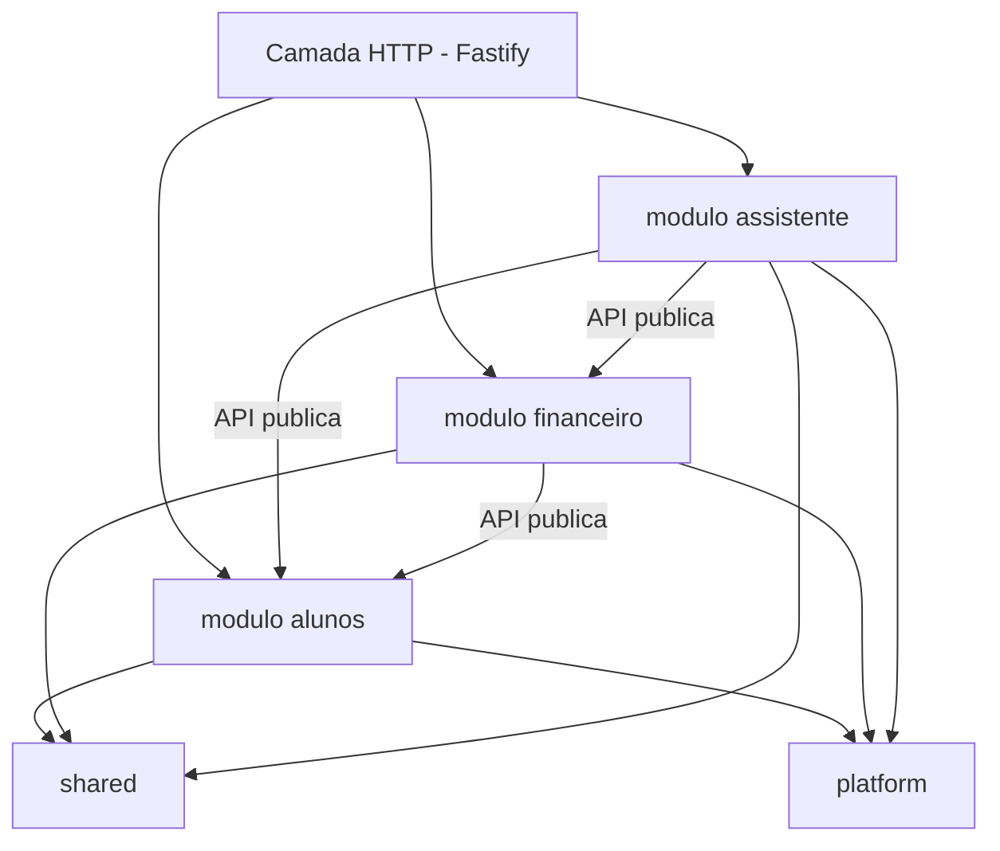

# 02 — Arquitetura

## 1. Estilo: monolito modular

Um único processo Node para o back-end e um único bundle React para o front-end,
mas com o back-end **organizado por domínio, não por camada técnica**. Não existe
uma pasta `controllers/` com todos os controllers do sistema; existe uma pasta
`alunos/` que contém o domínio, os casos de uso, a infraestrutura e as rotas de
alunos.

Por que isso importa neste teste especificamente: o item 4 do enunciado descreve
um bug de **regra de negócio vazando para a camada de apresentação** (a interface
decide quem é adimplente). A arquitetura que previne essa classe de bug é
exatamente a que isola a regra num núcleo de domínio sem dependências. A escolha
não é enfeite — é a resposta ao item 4.

## 2. Módulos

Três módulos de domínio, mais duas pastas de apoio.



| Módulo | Responsabilidade | Depende de |
|---|---|---|
| `alunos` | Cadastro: identidade, curso, matrícula, status acadêmico | — |
| `financeiro` | Parcelas e a regra de adimplência | `alunos` (API pública) |
| `assistente` | Orquestração do LLM, definição das ferramentas, modo demo | `alunos`, `financeiro` (API pública) |
| `shared` | Erros, dinheiro, datas, utilitários puros | — |
| `platform` | Servidor, configuração, conexão MySQL, plugins Fastify | — |

### Regras de dependência

Estas regras **DEVEM** valer e são verificadas pelo linter (ver doc 08):

1. `domain/` não importa nada fora do próprio `domain/` e de `shared/`.
   Sem Fastify, sem driver de banco, sem `fetch`.
2. `application/` importa `domain/` e as *portas* (interfaces); nunca um adaptador concreto.
3. `infra/` implementa portas. É o único lugar com SQL, HTTP de saída ou leitura de arquivo.
4. `http/` importa `application/`. Traduz HTTP ⇄ caso de uso e nada mais.
5. Um módulo só enxerga outro módulo pelo `index.js` dele. `assistente/` importando
   `alunos/infra/aluno.repository.mysql.js` é erro de lint.

A regra 5 é o que torna o monolito *modular* em vez de só um monolito. Se um dia
um módulo virar serviço, a fronteira já está desenhada.

## 3. Estrutura de pastas

```
facul-ai/
├─ docs/
├─ backend/
│  ├─ src/
│  │  ├─ modules/
│  │  │  ├─ alunos/
│  │  │  │  ├─ domain/
│  │  │  │  │  ├─ aluno.js                    # entidade + invariantes
│  │  │  │  │  └─ status-academico.js         # enum + validação
│  │  │  │  ├─ application/
│  │  │  │  │  ├─ listar-alunos.js
│  │  │  │  │  └─ obter-aluno.js
│  │  │  │  ├─ infra/
│  │  │  │  │  ├─ aluno.repository.memoria.js
│  │  │  │  │  └─ aluno.repository.mysql.js
│  │  │  │  ├─ http/
│  │  │  │  │  ├─ alunos.rotas.js
│  │  │  │  │  └─ alunos.schemas.js           # JSON Schema de req/res
│  │  │  │  └─ index.js                       # API pública do módulo
│  │  │  ├─ financeiro/
│  │  │  │  ├─ domain/
│  │  │  │  │  ├─ parcela.js
│  │  │  │  │  └─ situacao-financeira.js      # ← a regra do item 4
│  │  │  │  ├─ application/
│  │  │  │  │  └─ obter-financeiro-do-aluno.js
│  │  │  │  ├─ infra/
│  │  │  │  │  ├─ parcela.repository.memoria.js
│  │  │  │  │  └─ parcela.repository.mysql.js
│  │  │  │  ├─ http/
│  │  │  │  └─ index.js
│  │  │  └─ assistente/
│  │  │     ├─ domain/
│  │  │     │  └─ ferramentas.js              # definições JSON Schema das tools
│  │  │     ├─ application/
│  │  │     │  ├─ responder-pergunta.js       # o laço de tool use
│  │  │     │  └─ executar-ferramenta.js      # despacho tool → caso de uso
│  │  │     ├─ infra/
│  │  │     │  ├─ anthropic.provider.js       # integração real
│  │  │     │  └─ demo.provider.js            # roteador por intenção
│  │  │     ├─ http/
│  │  │     └─ index.js
│  │  ├─ shared/
│  │  │  ├─ erros.js                          # hierarquia de erros de aplicação
│  │  │  ├─ dinheiro.js                       # centavos: formatar, somar
│  │  │  └─ data.js                           # comparação por dia, fuso fixo
│  │  ├─ platform/
│  │  │  ├─ config.js                         # leitura e validação de env
│  │  │  ├─ servidor.js                       # montagem do Fastify
│  │  │  ├─ mysql.js                          # pool mysql2
│  │  │  └─ tratador-de-erros.js              # erro de domínio → HTTP
│  │  └─ main.js                              # entrypoint
│  ├─ seed/
│  │  └─ dados.json                           # alunos + parcelas fictícios
│  ├─ migrations/
│  │  └─ 001_schema.sql
│  ├─ .env.example
│  └─ package.json
├─ frontend/
│  ├─ src/
│  │  ├─ api/cliente.js                       # wrapper fetch + erros
│  │  ├─ hooks/useRequisicao.js               # loading / erro / dados
│  │  ├─ components/
│  │  │  ├─ ListaAlunos.jsx
│  │  │  ├─ CampoBusca.jsx
│  │  │  ├─ DetalheAluno.jsx
│  │  │  ├─ PainelFinanceiro.jsx
│  │  │  ├─ Assistente.jsx
│  │  │  └─ EstadoCarregando.jsx / MensagemErro.jsx
│  │  ├─ App.jsx
│  │  └─ main.jsx
│  ├─ index.html
│  └─ package.json
├─ mcp-server/                                 # bônus, ver doc 05 §6
├─ docker-compose.yml
├─ .env.example
└─ README.md
```

> `backend/` e `frontend/` são dois `package.json` independentes, sem workspaces.
> Workspaces adicionariam uma camada de ferramental que não paga por si num
> projeto de dois pacotes.

## 4. Portas e adaptadores

Três portas. Cada uma tem pelo menos dois adaptadores, e é essa dualidade que
permite rodar sem Docker e testar sem rede.

| Porta | Adaptadores | Escolhido por |
|---|---|---|
| `AlunoRepository` | `memoria` (seed JSON) · `mysql` | `PERSISTENCIA=memoria\|mysql` |
| `ParcelaRepository` | `memoria` (seed JSON) · `mysql` | idem |
| `LlmProvider` | `anthropic` · `demo` | presença de `ANTHROPIC_API_KEY` |

Contratos (JSDoc, não TypeScript — ver ADR 0002):

```js
/**
 * @typedef {object} AlunoRepository
 * @property {(filtro: FiltroAluno) => Promise<Pagina<Aluno>>} listar
 * @property {(id: string) => Promise<Aluno|null>} porId
 * @property {(matricula: string) => Promise<Aluno|null>} porMatricula
 * @property {(filtro: FiltroAluno) => Promise<number>} contar
 */

/**
 * @typedef {object} ParcelaRepository
 * @property {(alunoId: string) => Promise<Parcela[]>} porAluno
 * @property {(alunoIds: string[]) => Promise<Map<string, Parcela[]>>} porAlunos
 */

/**
 * @typedef {object} LlmProvider
 * @property {string} nome                       // 'anthropic' | 'demo'
 * @property {(ctx: ContextoDecisao) => Promise<Decisao>} decidir
 */
```

`porAlunos` existe para evitar N+1 na ferramenta `listar_alunos` quando ela
filtra por situação financeira — ela precisa das parcelas de todo mundo de uma vez.

## 5. Fluxo de uma requisição

### Caminho simples — `GET /api/alunos/:id/financeiro`

```
Fastify
  → valida params contra JSON Schema          (RNF-01)
  → obterFinanceiroDoAluno(id)                 application
      → alunoRepo.porId(id)                    infra  → 404 se null
      → parcelaRepo.porAluno(id)               infra
      → calcularSituacao(parcelas, hoje)       domain ← a regra, função pura
  → serializa resposta
```

A regra do item 4 é uma função pura no fim dessa cadeia. Ela não conhece HTTP,
não conhece banco, e recebe `hoje` como parâmetro — o que a torna testável sem
mocar relógio. Detalhes no doc 06.

### Caminho do assistente — `POST /api/assistente`

```
Fastify
  → valida body                                (RNF-01)
  → responderPergunta({ pergunta, alunoId })   application
      ↻ laço de tool use:
          provider.decidir(contexto)           infra (anthropic | demo)
          ├─ decisão = chamar ferramentas  → executarFerramenta() → módulos
          └─ decisão = resposta final      → sai do laço
  → { resposta, modo, ferramentasUsadas, fontes }
```

O laço vive em `application/` e é **o mesmo para os dois providers**. O que muda
entre modo real e modo demo é unicamente quem produz a `Decisao`. Doc 05 §4.

## 6. O que deliberadamente não fazemos

| Não usamos | Por quê |
|---|---|
| TypeScript | Ver ADR 0002. JSDoc + `checkJs` dá verificação de tipos sem etapa de build no back-end |
| ORM (Prisma, TypeORM) | Duas tabelas e cinco consultas. SQL direto com `mysql2` é menor, mais explícito e não esconde o N+1 |
| Biblioteca de estado no front (Redux, Zustand) | Uma tela, estado local resolve |
| Biblioteca de UI | O enunciado dispensa layout sofisticado |
| Monorepo com workspaces | Dois pacotes não justificam a camada de ferramental |
| Testes E2E | O enunciado pede testes unitários da regra financeira; E2E seria escopo além do pedido, e sem valor proporcional ao tempo |
