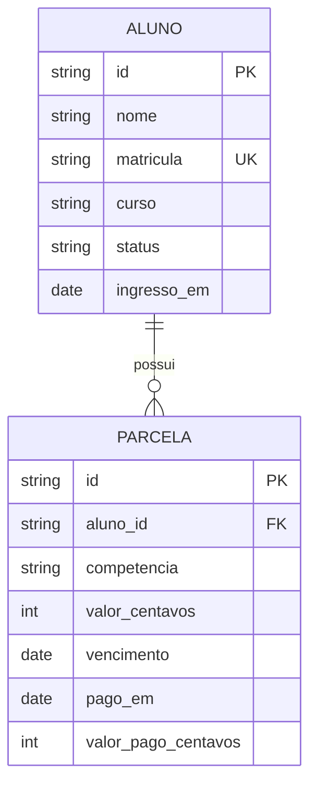

# 03 — Domínio e dados

## 1. Entidades

Duas entidades. A simplicidade é intencional: o enunciado pede "informações
financeiras básicas", e um modelo com parcelas individuais é o mínimo que
permite **derivar** a adimplência em vez de armazená-la (ver ADR 0006).



### Aluno

| Campo | Tipo | Regra |
|---|---|---|
| `id` | string (UUID v4) | imutável |
| `nome` | string | 3–120 caracteres, não vazio |
| `matricula` | string | **única**, formato `AAAA` + 6 dígitos (ex.: `2024000137`) |
| `curso` | string | 3–120 caracteres |
| `status` | enum | `ATIVO` · `TRANCADO` · `CANCELADO` · `FORMADO` |
| `ingressoEm` | date | não futura |

`status` é o **status acadêmico** da matrícula. Não tem relação nenhuma com
adimplência — essa separação é deliberada e é parte da prevenção do bug do item 4
(ver doc 06 §2). Um aluno `CANCELADO` pode ter parcelas vencidas em aberto; um
aluno `ATIVO` pode estar em dia.

### Parcela

| Campo | Tipo | Regra |
|---|---|---|
| `id` | string (UUID v4) | imutável |
| `alunoId` | string | referencia `Aluno.id` |
| `competencia` | string | `YYYY-MM`, o mês de referência da mensalidade |
| `valorCentavos` | integer | > 0 |
| `vencimento` | date | — |
| `pagoEm` | date \| null | `null` = não paga |
| `valorPagoCentavos` | integer \| null | `null` sse `pagoEm` é `null`; caso contrário > 0 |

**Invariantes** (validadas na construção da entidade, testadas unitariamente):

- `pagoEm === null` ⟺ `valorPagoCentavos === null`. Nunca um sem o outro.
- `(alunoId, competencia)` é único.
- `valorCentavos > 0`.
- `valorPagoCentavos`, quando presente, `> 0`. Pode ser **menor** que
  `valorCentavos` — isso é um pagamento parcial, e tem consequência na regra do
  doc 06.

### Dinheiro

Todo valor monetário é **inteiro, em centavos**, do banco ao JSON da API. Nenhum
`float` em nenhum ponto. `R$ 1.250,00` trafega como `125000`.

A formatação para `"R$ 1.250,00"` acontece **só no front-end**, via
`Intl.NumberFormat('pt-BR', { style: 'currency', currency: 'BRL' })`. A API nunca
devolve string formatada — isso é decisão de apresentação, e colocá-la no
back-end seria o mesmo tipo de vazamento de camada que causou o bug do item 4.

### Datas

Comparação de datas usa **apenas a parte de data**, no fuso `America/Sao_Paulo`.
Nunca `new Date() < vencimento` direto, porque `new Date()` é um instante em UTC
e às 22h de Brasília já é o dia seguinte em UTC — o que transformaria uma parcela
que vence hoje numa parcela vencida. Esse é um dos casos de teste obrigatórios
do doc 06 (caso 8).

`shared/data.js` expõe:

```js
hojeEm(fuso = 'America/Sao_Paulo') -> 'YYYY-MM-DD'
compararDatas(a, b) -> -1 | 0 | 1          // comparação lexicográfica de ISO
```

Strings ISO `YYYY-MM-DD` comparam corretamente por ordem lexicográfica, o que
elimina a classe inteira de bugs de fuso. É por isso que trafegamos datas como
string e não como `Date`.

## 2. Situação financeira — não é um campo

`SituacaoFinanceira` é um **valor derivado**, com dois estados:

```
ADIMPLENTE | INADIMPLENTE
```

Não existe coluna `situacao_financeira` na tabela `aluno`. Não existe campo
`situacao` na entidade `Aluno`. A situação é retornada por
`GET /api/alunos/:id/financeiro` e calculada em tempo de leitura pela função pura
`calcularSituacao(parcelas, hoje)`.

A regra completa, com os casos de borda e a tabela de testes, está no
[doc 06](06-regra-situacao-financeira.md). O ADR que registra essa escolha é o
[0006](adr/0006-situacao-derivada.md).

## 3. Schema MySQL

```sql
-- migrations/001_schema.sql

CREATE TABLE aluno (
  id           CHAR(36)     NOT NULL PRIMARY KEY,
  nome         VARCHAR(120) NOT NULL,
  matricula    VARCHAR(20)  NOT NULL,
  curso        VARCHAR(120) NOT NULL,
  status       ENUM('ATIVO','TRANCADO','CANCELADO','FORMADO') NOT NULL,
  ingresso_em  DATE         NOT NULL,
  CONSTRAINT uk_aluno_matricula UNIQUE (matricula),
  INDEX idx_aluno_nome (nome)
) ENGINE=InnoDB DEFAULT CHARSET=utf8mb4 COLLATE=utf8mb4_0900_ai_ci;

CREATE TABLE parcela (
  id                  CHAR(36) NOT NULL PRIMARY KEY,
  aluno_id            CHAR(36) NOT NULL,
  competencia         CHAR(7)  NOT NULL,          -- 'YYYY-MM'
  valor_centavos      INT      NOT NULL,
  vencimento          DATE     NOT NULL,
  pago_em             DATE     NULL,
  valor_pago_centavos INT      NULL,
  CONSTRAINT fk_parcela_aluno FOREIGN KEY (aluno_id) REFERENCES aluno(id) ON DELETE CASCADE,
  CONSTRAINT uk_parcela_aluno_competencia UNIQUE (aluno_id, competencia),
  CONSTRAINT ck_parcela_valor CHECK (valor_centavos > 0),
  CONSTRAINT ck_parcela_pagamento CHECK (
    (pago_em IS NULL AND valor_pago_centavos IS NULL)
    OR (pago_em IS NOT NULL AND valor_pago_centavos > 0)
  ),
  INDEX idx_parcela_aluno_venc (aluno_id, vencimento)
) ENGINE=InnoDB DEFAULT CHARSET=utf8mb4 COLLATE=utf8mb4_0900_ai_ci;
```

Notas:

- **Collation `utf8mb4_0900_ai_ci`**: *accent-insensitive* e *case-insensitive*.
  É o que faz `LIKE '%jose%'` encontrar "José" sem normalização manual (RF-02).
  O adaptador de memória replica isso normalizando com
  `.normalize('NFD').replace(/\p{Diacritic}/gu, '').toLowerCase()`.
- **`ck_parcela_pagamento`** põe a invariante "pago ⟺ tem valor pago" no banco,
  além do domínio. Defesa em profundidade: é exatamente a inconsistência que
  produziria o bug do item 4 se a situação fosse persistida.
- **Sem coluna de situação.** Intencional. Ver ADR 0006.
- `ON DELETE CASCADE` porque parcela não tem vida própria fora do aluno.

## 4. Seed

`backend/seed/dados.json` é a **única fonte** dos dados fictícios. O adaptador de
memória lê esse arquivo na inicialização; o adaptador MySQL o carrega via script
de seed. Um único arquivo garante que os dois modos de persistência mostrem
exatamente os mesmos dados — sem isso, um bug reproduzível em memória pode
sumir no MySQL e vice-versa.

### Composição exigida

O seed **DEVE** cobrir todos os casos de borda do doc 06, para que o avaliador
consiga reproduzir cada um pela interface, sem escrever teste:

| # | Perfil | Serve para demonstrar |
|---|---|---|
| 1 | `ATIVO`, todas as parcelas pagas em dia | Caminho feliz |
| 2 | `ATIVO`, uma parcela vencida há 40 dias em aberto | Inadimplência clara |
| 3 | `ATIVO`, parcela vencendo **hoje**, não paga | Vence hoje ≠ vencido (caso 3) |
| 4 | `ATIVO`, parcela paga **com atraso** | Atraso passado ≠ inadimplência atual (caso 5) |
| 5 | `TRANCADO`, parcela vencida em aberto | Status acadêmico ≠ situação financeira |
| 6 | `FORMADO`, tudo quitado | Idem, pelo lado oposto |
| 7 | `ATIVO`, **pagamento parcial** de parcela já vencida | Parcial não quita (caso 7) |
| 8 | `ATIVO`, só parcelas futuras em aberto | A vencer ≠ vencido (caso 6) |
| 9 | `CANCELADO`, sem nenhuma parcela | Conjunto vazio é adimplente (caso 1) |
| 10–12 | Variações para dar volume e testar busca/paginação | RF-01, RF-02 |

As datas do seed são **relativas à data de execução**, geradas por um script
(`npm run seed:gerar`) a partir de deslocamentos (`-40d`, `+0d`, `+30d`) e
gravadas como datas absolutas no JSON. Datas fixas no arquivo apodreceriam: o
caso "vence hoje" deixaria de testar o que precisa testar no dia seguinte.

> Dados fictícios. Nomes gerados; nenhum dado pessoal real (RNF-03, item 5 do
> enunciado).

## 5. Formato de serialização

O que sai pela API, por entidade. Contrato completo no [doc 04](04-contrato-api.md).

```jsonc
// Aluno
{
  "id": "3f2a…",
  "nome": "Helena Marques",
  "matricula": "2024000137",
  "curso": "Engenharia de Software",
  "status": "ATIVO",
  "ingressoEm": "2024-02-19"
}

// Parcela
{
  "id": "9c81…",
  "competencia": "2026-09",
  "valorCentavos": 125000,
  "vencimento": "2026-09-10",
  "pagoEm": null,
  "valorPagoCentavos": null,
  "situacao": "VENCIDA"          // derivada: PAGA | VENCIDA | A_VENCER
}
```

`Parcela.situacao` também é derivada, nunca persistida, pelo mesmo motivo que a
situação do aluno. Ela existe na resposta porque o front precisa destacar
*quais* parcelas justificam a inadimplência (RF-13) — a interface mostra a
evidência, não só o veredito.
