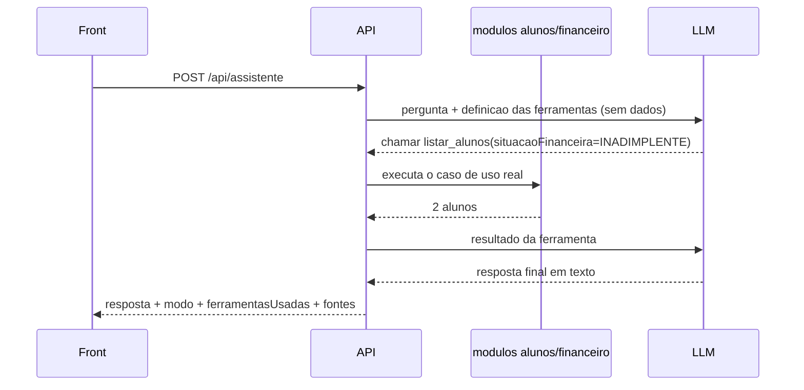
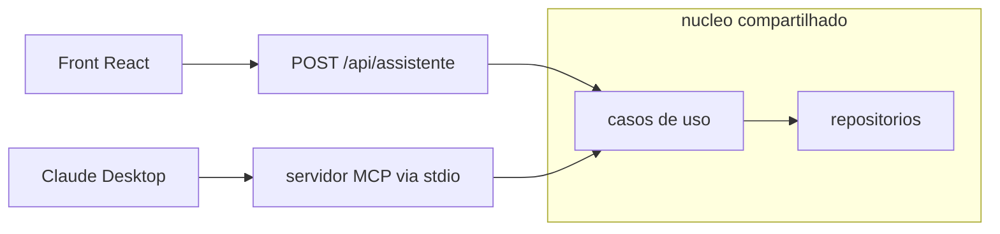

# 05 — Assistente de IA

Atende os requisitos RF-06, RF-07, RF-08 e RNF-03 a RNF-06, e o item 3 do
enunciado.

## 1. Por que *tool use*, e não um prompt com os dados

A abordagem ingênua para "responder perguntas sobre os dados" é serializar o
banco inteiro no prompt e pedir ao modelo que responda. Ela falha em dois
requisitos explícitos do enunciado de uma vez:

> *Enviar ao modelo somente os dados necessários.*
> *Evitar que o modelo invente informações não existentes nos dados.*

Um dump no prompt envia tudo por definição, e deixa o modelo livre para
interpolar entre os registros.

A abordagem correta é **tool use** (chamada de função): o back-end envia ao
modelo a pergunta e a *descrição* de um conjunto de ferramentas de consulta,
sem nenhum dado. O modelo responde pedindo uma chamada (`listar_alunos({ situacaoFinanceira: "INADIMPLENTE" })`),
o back-end executa essa chamada contra os módulos reais, devolve o resultado, e
o modelo redige a resposta final a partir dele.



Três propriedades que caem de graça desse desenho:

1. **Minimização de dados.** Só trafega o recorte que a ferramenta devolveu.
   Um aluno não relacionado à pergunta nunca sai do processo.
2. **Grounding.** O modelo não tem outra fonte além dos resultados. Não há o que
   interpolar.
3. **Auditabilidade.** O back-end sabe exatamente quais consultas foram feitas, e
   devolve isso em `ferramentasUsadas` e `fontes`.

A relação disso com MCP — e por que MCP **não** é o mecanismo correto aqui —
está no [ADR 0004](adr/0004-tool-use-em-vez-de-mcp.md). Resumo: MCP é o protocolo
inverso (expor suas ferramentas a um cliente LLM externo). Fica como bônus, §6.

## 2. As ferramentas

Quatro, com schema estrito. Cada uma mapeia direto para um caso de uso que já
existe para servir os endpoints REST — o assistente não tem nenhum caminho
privilegiado até os dados.

| Ferramenta | Parâmetros | Caso de uso |
|---|---|---|
| `listar_alunos` | `status?`, `situacaoFinanceira?`, `busca?`, `limite?` | `listarAlunos` |
| `obter_aluno` | `matriculaOuNome` | `obterAluno` |
| `obter_financeiro` | `alunoId` | `obterFinanceiroDoAluno` |
| `contar_alunos` | `status?`, `situacaoFinanceira?` | `contarAlunos` |

`contar_alunos` existe por um motivo específico: a pergunta de exemplo do
enunciado *"Quantos alunos estão com matrícula ativa?"* é uma **agregação**.
Sem uma ferramenta de contagem, o modelo listaria todos e contaria no texto —
gastando tokens e errando quando a lista passa do limite de paginação. Dar a
ferramenta certa é mais barato e mais correto que confiar na aritmética do modelo.

Definição (JSON Schema, com `strict: true`):

```js
{
  name: 'listar_alunos',
  description:
    'Lista alunos do sistema acadêmico, com filtros opcionais. Use quando a ' +
    'pergunta envolver mais de um aluno, ou pedir um recorte por status ' +
    'acadêmico ou por situação financeira. A situação financeira é calculada ' +
    'a partir das parcelas; não é um campo armazenado.',
  strict: true,
  input_schema: {
    type: 'object',
    properties: {
      status: { type: ['string','null'], enum: ['ATIVO','TRANCADO','CANCELADO','FORMADO', null] },
      situacaoFinanceira: { type: ['string','null'], enum: ['ADIMPLENTE','INADIMPLENTE', null] },
      busca: { type: ['string','null'], description: 'Trecho de nome ou matrícula' },
      limite: { type: ['integer','null'], description: 'Padrão 20, máximo 50' },
    },
    required: ['status','situacaoFinanceira','busca','limite'],
    additionalProperties: false,
  },
}
```

`strict: true` exige `additionalProperties: false` e que **todos** os campos
estejam em `required` — opcionalidade se expressa aceitando `null`. Em troca, a
API garante que `tool_use.input` valida contra o schema, o que elimina a
validação defensiva no despacho.

**Limite rígido de 50 registros por chamada**, aplicado no back-end e não
confiado ao modelo. É o teto de quanto dado pode entrar no contexto por consulta
(RNF-04).

## 3. O laço de tool use

Implementado à mão em `application/responder-pergunta.js`, ~40 linhas. O SDK
oferece um `toolRunner` que faria esse laço sozinho; não o usamos, e a razão
está no [ADR 0005](adr/0005-modo-demo.md): o laço manual é compartilhado pelos
dois providers (real e demo), e é essa partilha que faz o modo demonstrativo
exercitar o código de produção em vez de ser uma fachada.

```js
// pseudocódigo — a forma, não a implementação final
async function responderPergunta({ pergunta, alunoId }, { provider, deps }) {
  let mensagens = [{ role: 'user', content: montarPrimeiroTurno(pergunta, alunoId) }];
  const usadas = [];
  const fontes = [];

  for (let volta = 0; volta < MAX_VOLTAS; volta++) {
    const decisao = await provider.decidir({ mensagens, ferramentas: FERRAMENTAS });

    if (decisao.tipo === 'resposta') {
      return { resposta: decisao.texto, modo: provider.nome, ferramentasUsadas: usadas, fontes };
    }

    // decisao.tipo === 'ferramentas' — pode vir mais de uma, em paralelo
    mensagens.push({ role: 'assistant', content: decisao.conteudoBruto });

    const resultados = await Promise.all(
      decisao.chamadas.map(c => executarFerramenta(c, deps)),
    );
    resultados.forEach((r, i) => {
      usadas.push(decisao.chamadas[i].nome);
      fontes.push(...r.fontes);
    });

    // TODOS os tool_result num ÚNICO turno de usuário
    mensagens.push({ role: 'user', content: resultados.map(r => r.bloco) });
  }

  throw new ErroDeAplicacao('IA_RESPOSTA_INVALIDA', 'Limite de iterações excedido.');
}
```

Quatro detalhes que são erro comum e que o código **DEVE** acertar:

1. **Empilhar `decisao.conteudoBruto` inteiro**, não só o texto. Os blocos
   `tool_use` precisam voltar ao modelo na íntegra, ou a próxima requisição é
   rejeitada por `tool_use` sem `tool_result` correspondente.
2. **Todos os `tool_result` num único turno de usuário.** O modelo pode pedir
   várias ferramentas de uma vez; espalhar os resultados em turnos separados o
   ensina a parar de paralelizar.
3. **`MAX_VOLTAS = 5`.** Sem teto, uma decisão ruim vira laço infinito com custo.
4. **Checar `stop_reason` antes de ler `content`.** Ver §5.

## 4. Os dois providers

A porta `LlmProvider` tem um método: `decidir(contexto) -> Decisao`. O laço acima
não sabe qual implementação está rodando.

### `anthropic.provider.js` — integração real

```js
import Anthropic from '@anthropic-ai/sdk';

const client = new Anthropic({
  // apiKey vem de ANTHROPIC_API_KEY no ambiente; nunca hardcoded
  timeout: 20_000,   // ms — o padrão do SDK é 10 min, inviável num request web
  maxRetries: 2,     // o SDK já faz backoff em 408/409/429/5xx
});

const resposta = await client.messages.create({
  model: 'claude-opus-5',
  max_tokens: 8192,
  system: PROMPT_DE_SISTEMA,
  tools: FERRAMENTAS,
  messages: mensagens,
  output_config: { effort: 'low' },
});
```

Decisões de parâmetro, cada uma com motivo:

| Parâmetro | Valor | Por quê |
|---|---|---|
| `model` | `claude-opus-5` | Modelo atual da linha Opus. Configurável por `ANTHROPIC_MODEL` para quem quiser testar com `claude-haiku-4-5` e gastar menos |
| `output_config.effort` | `low` | As perguntas são consultas simples sobre um conjunto pequeno. `low` reduz latência e custo sem perder qualidade aqui. É o principal controle de custo |
| `thinking` | **não enviado** | No Claude Opus 5 o *thinking* é ligado por padrão, e é isso que queremos. Desligar explicitamente tem dois modos de falha conhecidos em carga de tool use: o modelo ocasionalmente escreve a chamada de ferramenta como **texto visível** em vez de emitir um bloco `tool_use` — a chamada nunca executa, nenhum erro é levantado — e pode vazar tags `<thinking>` na resposta. Controlar custo com `effort: low` é mais seguro que desligar o raciocínio |
| `max_tokens` | `8192` | **Teto de `thinking` + texto somados.** Com *thinking* ligado, um valor apertado trunca a resposta no meio. As respostas reais ficam em algumas centenas de tokens; `max_tokens` é teto, não alvo, e só se paga o que for gerado |
| `timeout` | `20_000` | Milissegundos no SDK de TypeScript — não segundos. Vira `504 IA_TIMEOUT` |
| `maxRetries` | `2` | Padrão do SDK. Já cobre 429 e 5xx com backoff exponencial; não reimplementar |

### `demo.provider.js` — modo demonstrativo

Mesma interface. Em vez de chamar a rede, classifica a pergunta por intenção
(palavras-chave e regex sobre texto normalizado), escolhe a ferramenta
correspondente e devolve a mesma estrutura `Decisao`. Na segunda volta do laço,
recebe o resultado da ferramenta e formata com um template.

| Intenção detectada | Ferramenta escolhida |
|---|---|
| `inadimplent*`, `devendo`, `em atraso` | `listar_alunos({ situacaoFinanceira: 'INADIMPLENTE' })` |
| `quantos`, `total de`, `número de` | `contar_alunos({ ... })` |
| `resum*` + `alunoId` em foco | `obter_financeiro({ alunoId })` |
| matrícula ou nome próprio reconhecido | `obter_aluno({ matriculaOuNome })` |
| nenhuma acima | resposta de fallback listando o que ele sabe responder |

**O ponto do desenho:** o modo demo não é um mock. Ele percorre o mesmo laço, o
mesmo despacho de ferramentas, os mesmos casos de uso, os mesmos repositórios e
a mesma verificação de grounding. O que é simulado é unicamente *a decisão de
qual ferramenta chamar* — a parte que o LLM faria. Tudo depois disso é código de
produção.

Consequência prática: a suíte de testes roda sem chave e sem rede, exercitando
~90% do caminho real. E o que está de fato implementado versus demonstrado fica
delimitado com precisão — é um arquivo.

### Seleção

```js
export function criarProvider(config) {
  return config.anthropicApiKey
    ? criarAnthropicProvider(config)
    : criarDemoProvider(config);
}
```

Sem chave, a aplicação **sobe normalmente** em modo demo e diz isso em
`GET /api/health` e em cada resposta do assistente (RF-08). Não falha na
inicialização: um avaliador sem chave precisa conseguir rodar o projeto inteiro.

## 5. Grounding — as quatro barreiras

O requisito *"evitar que o modelo invente informações"* não se resolve com uma
frase no prompt. São quatro mecanismos, em profundidade:

**Barreira 1 — arquitetural.** O modelo nunca recebe dados no turno inicial.
A única via de acesso são as ferramentas. Não há o que alucinar *a partir de*.

**Barreira 2 — prompt de sistema.**

```
Você é um assistente de consulta de um sistema de gestão acadêmica.

Responda EXCLUSIVAMENTE com base nos resultados das ferramentas desta conversa.

- Se os resultados não contiverem a resposta, diga que a informação não está
  disponível. Não estime, não deduza, não complete.
- Nunca invente nomes, matrículas, valores ou datas.
- Ao citar um aluno, use o nome e a matrícula exatamente como vieram da ferramenta.
- Valores monetários chegam em centavos (125000 = R$ 1.250,00). Converta ao exibir.
- A situação financeira é calculada a partir das parcelas e da data de hoje.
  Nunca afirme que um aluno está adimplente ou inadimplente sem ter obtido suas
  parcelas por meio de uma ferramenta.
- Responda em português do Brasil, de forma objetiva.
```

**Barreira 3 — verificação pós-resposta.** Antes de devolver ao cliente:

```js
if (ferramentasUsadas.length === 0 && pareceAfirmacaoFactual(resposta)) {
  throw new ErroDeAplicacao('IA_RESPOSTA_INVALIDA',
    'O assistente respondeu sem consultar os dados.');
}
```

Uma resposta factual sem nenhuma ferramenta chamada é, por construção, uma
resposta sem fonte. Vira `502`, não chega ao usuário. (Saudações e pedidos de
esclarecimento passam — `pareceAfirmacaoFactual` filtra por presença de números,
nomes próprios ou afirmações sobre alunos.)

**Barreira 4 — a resposta é auditável.** `ferramentasUsadas` e `fontes` vão no
payload. O avaliador compara a resposta com `GET /api/alunos/:id/financeiro` de
cada fonte citada e confere.

## 6. Tratamento de erros do provedor

Usar as classes de exceção tipadas do SDK, encadeadas da mais específica para a
mais genérica. Nunca casar string de mensagem de erro.

```js
import Anthropic from '@anthropic-ai/sdk';

try {
  // ...
} catch (e) {
  if (e instanceof Anthropic.AuthenticationError)   throw erro('IA_INDISPONIVEL', 503, e);  // chave inválida: problema nosso
  if (e instanceof Anthropic.PermissionDeniedError) throw erro('IA_INDISPONIVEL', 503, e);
  if (e instanceof Anthropic.NotFoundError)         throw erro('IA_INDISPONIVEL', 503, e);  // model id errado
  if (e instanceof Anthropic.RateLimitError)        throw erro('LIMITE_DE_REQUISICOES', 429, e);
  if (e instanceof Anthropic.APIConnectionTimeoutError) throw erro('IA_TIMEOUT', 504, e);
  if (e instanceof Anthropic.APIConnectionError)    throw erro('IA_INDISPONIVEL', 503, e);
  if (e instanceof Anthropic.APIError && e.status >= 500) throw erro('IA_INDISPONIVEL', 503, e);
  throw e;
}
```

`AuthenticationError` vira `503` e não `401` de propósito: do ponto de vista do
cliente da nossa API, uma chave nossa inválida é indisponibilidade do serviço —
ele não tem o que fazer com um `401`. O detalhe real vai para o log.

### `stop_reason` antes de `content`

```js
if (resposta.stop_reason === 'refusal') {
  throw erro('IA_RESPOSTA_INVALIDA', 502, { categoria: resposta.stop_details?.category });
}
```

Uma recusa por classificador de segurança retorna **HTTP 200** com
`stop_reason: 'refusal'` e `content` vazio ou parcial. Código que lê
`resposta.content[0].text` direto quebra com `TypeError` nesse caminho. Em um
assistente sobre dados acadêmicos fictícios a recusa é improvável, mas a
checagem custa duas linhas e a ausência dela é um `500` não tratado.

Também checar `stop_reason === 'max_tokens'`: indica resposta truncada, e deve
virar `502` em vez de entregar texto cortado ao meio.

## 7. Segurança da chave (RNF-03)

| Controle | Como |
|---|---|
| A chave só existe no back-end | O front **nunca** fala com a Anthropic. Todo tráfego passa por `POST /api/assistente` |
| Nunca no bundle | Nada de `VITE_ANTHROPIC_*` — qualquer `VITE_*` é embutido no JS servido ao navegador |
| Nunca no repositório | `.env` no `.gitignore`; `.env.example` com placeholder |
| Nunca em log | O logger redige `authorization`, `x-api-key` e qualquer chave batendo `/^sk-ant-/` |
| Verificável | `npm run check:secrets` roda `grep -rE "sk-ant-[A-Za-z0-9_-]{20,}"` na árvore versionada e falha o CI se achar |

## 8. MCP — bônus, depois do núcleo

Com os casos de uso isolados, expor as mesmas quatro ferramentas por
[MCP](https://modelcontextprotocol.io) é um adaptador fino sobre `application/`
— nenhuma lógica nova, só um transporte diferente. Isso permitiria conectar o
Claude Desktop (ou qualquer cliente MCP) diretamente aos dados acadêmicos.

```
mcp-server/
├─ src/servidor.js      # @modelcontextprotocol/sdk, transporte stdio
└─ README.md            # como registrar no Claude Desktop
```



**Status: não iniciado.** É explicitamente opcional e só começa depois de itens
1 a 5 do enunciado fecharem. Se entregue, o README marca como extra; se não, o
README explica o desenho e por que o adaptador seria barato — que é o ponto
arquitetural que interessa demonstrar de qualquer forma.
